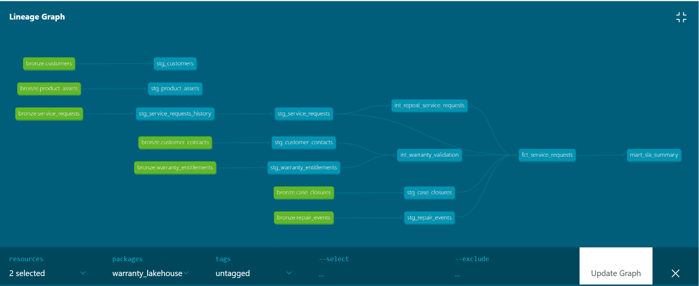

## dbt project (Databricks)

A layered dbt project on Databricks that turns warranty, service-request and repair data into an SLA mart.



| Layer | Models | Grain |
|---|---|---|
| Staging (views) | 8 `stg_*` models | one row per business key, latest version |
| Intermediate (views) | `int_warranty_validation`, `int_repeat_service_requests` | per contact, per service request |
| Marts (tables) | `fct_service_requests`, `mart_sla_summary` | per service request, per region and priority |

**Quality:** 63 data tests and 2 unit tests. `dbt build` passes with 4 known, intentional warnings (a planted bad channel, a planted orphan asset, and 2 requests whose contacts are not in the loaded data).

**Design decisions**
- Suspicious rows are flagged, never deleted.
- Warranty coverage is derived from entitlement dates, not from the raw status (which goes stale).
- SLA is measured to closure against each request's own due time, using one explicit `as_of_ts` instead of `current_timestamp()`, so results are reproducible.
- Business rules with no coverage in the loaded data (SLA breach, repeat after closure) are proved with unit tests on made-up rows.

**Run it**
```bash
cd dbt
dbt debug   # check the Databricks connection configured in profiles.yml
dbt build   # models and tests in dependency order
```
