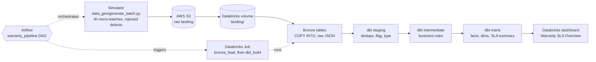
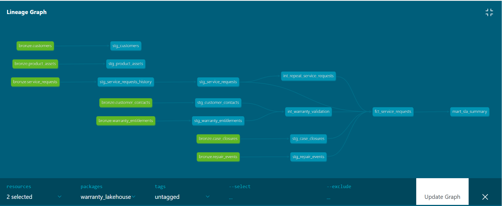
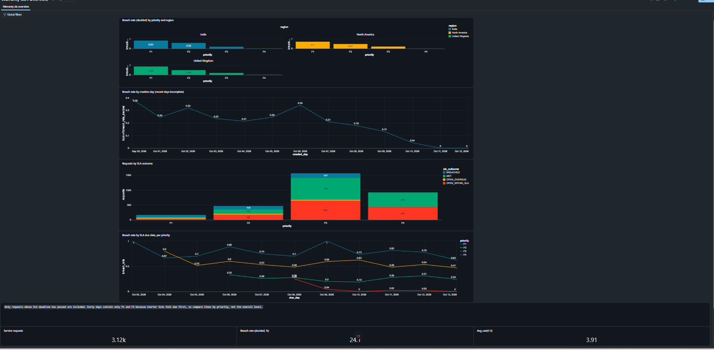

# Warranty-lakehouse

An end-to-end, orchestrated data pipeline for warranty, service-request and repair analytics, built on **free tiers only**: a data simulator, AWS S3, Airflow, Databricks (Free Edition) and dbt, ending in an SLA dashboard.

It is the v2 of my Snowflake warranty project: same business problem (SLA breach, repeat service, warranty validation), rebuilt as a lakehouse with orchestration and data-quality tests.

## Architecture



| Stage | What happens | Tool |
|---|---|---|
| Generate | One run creates 6 four-hour batches (one simulated day) with realistic late, duplicate and bad rows | Python |
| Land | Data files go to S3 first, the batch manifest last, so a batch only "exists" once complete | boto3 |
| Copy | Batches in S3 but not yet in the volume are copied into the Databricks volume (Free Edition cannot read S3 directly) | Airflow, Files API |
| Load | `COPY INTO` appends new files to bronze tables; re-runs only load new files | Databricks SQL |
| Transform | Staging, intermediate and marts, with tests | dbt |
| Serve | Live dashboard on the marts | Databricks dashboard |

## Orchestration

The Airflow DAG `warranty_pipeline` runs daily at 06:00 IST:

`generate_batch` -> `upload_to_s3` -> `s3_to_volume` -> `run_databricks_job`

The Databricks job `warranty_dbt_build` has two tasks, `bronze_load` (SQL file from this repo) and `dbt_build` (`dbt build`). It has no schedule of its own: Airflow owns the schedule. The DAG uses `max_active_runs=1` and `catchup=False`, because the generator keeps state and two overlapping runs would clash. Airflow runs in a GitHub Codespace, so it only fires while the Codespace is awake; in production this would run on a managed scheduler.

**Reliability:** when an Airflow task fails for good, a push alert goes to my phone through ntfy.sh. The idempotent tasks (S3 upload, volume copy, job trigger) retry first; the generator does not, because it advances state and a retry could skip or duplicate a batch. The Databricks job also emails on failure and warns when a run takes more than 10 minutes. `dbt source freshness` runs before `dbt build` and checks `_loaded_at` on every bronze table (warn after 26 hours, error after 50), so a silent "no new data" failure stops the build instead of producing a stale dashboard.

## Data model (dbt)



| Layer | Models | Grain |
|---|---|---|
| Bronze | 7 tables, raw JSON string plus `_source_file` and `_loaded_at` | one row per raw record version |
| Staging (views) | 8 `stg_*` models | one row per business key, latest version |
| Intermediate (views) | `int_warranty_validation`, `int_repeat_service_requests` | per contact, per service request |
| Marts (tables) | `fct_service_requests`, `mart_sla_summary`, `dim_customers`, `dim_assets` | per request, per region and priority, per customer, per asset |

**Quality:** 14 models, 69 data tests, 2 unit tests, 1 exposure. `dbt build` finishes with 0 errors and 6 known warnings, each traced to a defect the simulator plants on purpose:

| Warning | Planted defect |
|---|---|
| `FAX_SUPPORT` channel | invalid channel value |
| CSAT score 9 | out-of-range survey score |
| Repair events with unknown `sr_id` (`SR-9999999`) | orphan child rows |
| Service requests and fact rows with unknown asset (`AST-999999`) | orphan asset |
| Requests whose contact is missing | contact rows with null keys |

## Design decisions

- **Flag, never delete.** Suspicious rows get `is_*` columns, so the raw story stays intact.
- **Warranty coverage is derived** from entitlement dates, not from the raw status, which goes stale.
- **Reproducible SLA results.** SLA is measured against each request's own due time, using one explicit `as_of_ts` (default: the latest `updated_at`) instead of `current_timestamp()`.
- **Right-censoring is handled.** `breach_rate_decided` only counts requests whose outcome is known (MET, BREACHED, OPEN_OVERDUE), so open requests do not drag the rate down.
- **Grain is proved before every join.** Fan-out checks, left joins, and an explicit `UNKNOWN` / `NO_CONTACT_MATCH` label for unmatched keys.
- **Rules with no data coverage are unit-tested** on mocked rows (SLA outcome rule, repeat-after-closure rule).
- **Orphans are `severity: warn`, not errors.** They are expected on child tables; the build still stops on real failures.
- **Idempotent loads.** `COPY INTO` remembers loaded files and `s3_to_volume` copies only missing batches, so reruns never duplicate data.
- **Freshness on load time.** Source freshness uses `_loaded_at` (when the pipeline delivered the file), not the business timestamp, because event times in the simulation are always in the past.

## Dashboard



*Screenshot taken at batch 75 (simulated time up to 13 Oct 2026): 3.12k requests, 24.1% decided breach rate, average CSAT 3.91.*

Dataset SQL is in [`dashboard/warranty_sla_overview.sql`](dashboard/warranty_sla_overview.sql), and the dbt exposure `warranty_sla_overview_dashboard` links it to the marts.

What the data shows, and what it does not:
- Trend by created date falls at the end because of **right-censoring**: recent requests are still open.
- Trend by SLA due date (all priorities blended) falls because of **priority mix**: P1 falls due first and P4 last. Compare per-priority lines, not the blended one.
- Per priority, the breach rates are roughly flat over the simulated period.

## Run it

```bash
# 1. dbt only (against existing bronze tables)
cd dbt
dbt debug
dbt build

# 2. full pipeline: start Airflow from the Codespace, then trigger the DAG
bash airflow/start_airflow.sh
```

Secrets (`DATABRICKS_HOST`, `DATABRICKS_TOKEN`, `AWS_*`) are Codespaces secrets and never live in the repo. The AWS user is limited to one bucket and cannot delete objects.

## Repo layout

| Path | Purpose |
|---|---|
| `data_gen/` | simulator and volume uploader |
| `airflow/` | DAG (`dags/warranty_pipeline.py`) and start script |
| `databricks/sql/` | bronze `COPY INTO` load script |
| `dbt/` | staging, intermediate, marts, tests, docs |
| `dashboard/` | dashboard dataset SQL and screenshots |

## Stack

Python, AWS S3, Apache Airflow 3, Databricks Free Edition (Unity Catalog volume, SQL warehouse, Jobs, dashboards), dbt-core with dbt-databricks, GitHub Codespaces.

## Limits (honest notes)

- Free Edition has one small SQL warehouse and restricted outbound internet, which is why S3 data is copied into a volume instead of being read directly.
- Airflow runs in a Codespace, so schedules do not fire while it is stopped.
- The data is simulated; the 13 simulated days cover only a short window, so long-term trends are not visible.
